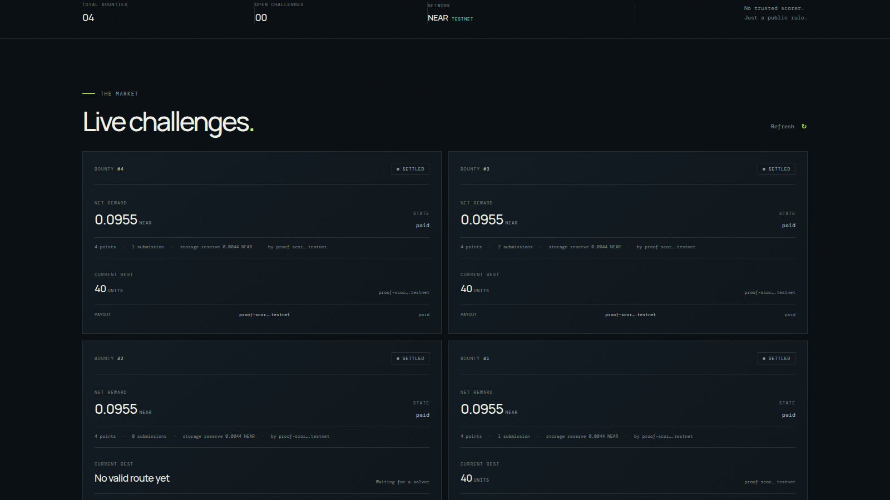

# Proof-of-Score Bounty

**An optimization bounty market where the NEAR contract—not an off-chain judge—recomputes every submitted score.**

[Open the hosted testnet demo](https://taku629.github.io/ear-proof-of-score/) · [Watch the ~49-second demo video](./docs/demo-video.mp4) · [Source repository](https://github.com/taku629/ear-proof-of-score)



A creator posts a 3–40 point Euclidean travelling-salesperson (TSP) problem and locks testnet NEAR. Human solvers or agents submit routes. The Rust contract validates each route and calculates its integer score; after the deadline, the best solver can claim the net bounty. If nobody submits, the creator can claim the net bounty back. A storage reserve remains in the contract. A separate off-chain practice lab and local Python mode can solve larger instances up to 2,000 points, but those results are not accepted by the deployed contract.

> **Prototype — NEAR testnet only.** Never use mainnet funds with this app. The contract proves that a route was scored by the published rule; it does not prove global optimality or that a submission came from an AI agent.

## What works

- **Rust smart contract:** Creates a bounty, enforces deadlines, validates complete routes, scores them on-chain, tracks the best valid result, permits finalization, and supports a winner payout or creator refund. The attached deposit is split into a net bounty and a permanent-storage reserve (measured state size plus a 256-byte buffer).
- **Python solver agent:** Reads an open challenge from NEAR JSON-RPC or local input. It keeps the existing all-start solver for 3–40 on-chain-compatible points and adds a deterministic, bounded 8-start candidate-2-opt practice mode for 41–2,000 local points. It produces a candidate only; it does not hold a key or send a transaction.
- **Web dApp:** Reads live testnet challenges, connects a testnet wallet, creates a bounty, generates/submits routes, finalizes a challenge, and lets the authorized recipient claim. A separate Web Worker practice lab generates and solves up to 2,000 cities locally without a wallet, RPC write, or stored result.
- **Deterministic score:** For each tour edge, add `floor(sqrt((x1-x2)^2 + (y1-y2)^2))`, including the return edge to the first point. Lowest total wins. Exact ties keep the first submitted route.

## Try the live demo

1. Open the [hosted testnet demo](https://taku629.github.io/ear-proof-of-score/). It reads public NEAR testnet state; connecting a wallet is not required to browse.
2. The deployed demo currently shows four settled history items and **zero open bounties**. The market labels that state honestly; there is no funded challenge to submit to until someone creates one.
3. To try a larger problem now, open **Offline practice** and choose 100–2,000 cities. The browser generates a reproducible instance and draws a candidate route. Nothing is saved or sent to NEAR; the heuristic does not prove optimality, and routes above 40 cities cannot be submitted to this contract.
4. To start a real testnet challenge, open **Post a bounty**, enter 3–40 point coordinates, a total deposit, and a duration, connect a faucet-funded **testnet** wallet, then approve the transaction. The deposit is split between a storage reserve and the net prize. Never use mainnet funds.
5. Once an open challenge exists, click **Generate candidate**. The contract—not the local solver—computes the official score.
6. To submit for real, connect a **testnet** wallet, paste or keep the route, click **Submit route**, and approve the transaction in the wallet. After refreshing, the contract's stored best score and solver are shown. A wallet signature is required for every write.
7. After a challenge deadline, anyone can call **Finalize challenge**. The chosen recipient then calls **Claim payout**. These are explicit on-chain transactions; the UI does not make a payment automatically.

The deployment's completed testnet checks are listed in [testnet verification](./docs/testnet-verification.md), with public explorer links. They include valid scoring, invalid-route rejection, best-route replacement, a winner payout, a no-submission refund, and a payout to a distinct solver account.

## Why NEAR

The bounty, challenge rules, best-score state, and settlement all live in a NEAR smart contract, so no private operator or scoring oracle decides which route is eligible for a reward. The web app and Python solver read NEAR testnet through FastNear, while Hot Labs' `@hot-labs/near-connect` handles wallet signing. A narrowly scoped, tested compatibility patch makes Meteor Wallet receive the actual dApp page URL instead of the sandbox iframe URL; it fails closed if the upstream executor changes. The contract uses Rust and `near-sdk`; the solver is Python; the frontend is Vite and JavaScript.

This prototype settles on NEAR testnet directly. It does **not** use NEAR Intents, Chain Signatures, NEAR AI Cloud, or a paid AI API; they are not required for the core on-chain scoring experiment. See [the official hackathon checklist](./docs/official-hackathon-rules.md) for the current submission constraints.

**Track fit:** Agent Economy (`agents`) and Open Innovation (`open`) are the closest matches: independent solvers can earn from a public bounty market, and the idea explores a new way for optimization work to be rewarded. In this version solvers compete; they do not coordinate as an AI swarm, so the project does not claim swarm coordination.

## Testnet deployment and verification

- **Contract ID:** `proof-score-bounty-1105.testnet` (testnet only; faucet-funded and separate from any mainnet prize account).
- [Deployment transaction](https://explorer.testnet.near.org/transactions/J7bbN4wQL1knS7KQVrxwseXe169axprNGQb7Edb9y5NL) · [Initialization transaction](https://explorer.testnet.near.org/transactions/21APGbQhsg8Gekg99ymd7WecHMZe2ZBoHNk3Ca7frp1T).
- A valid route scored 40; a later score-40 route replaced an earlier score-48 route; a duplicate-point route was rejected.
- Winner payout and no-submission creator refund both completed. A separate solver account received the net bounty; its final on-chain status was `paid` ([submission](https://explorer.testnet.near.org/transactions/6wtr5xpnC7a1itrH4KVcHj5erijYEQMFSyTXQZEEY1tV) · [claim](https://explorer.testnet.near.org/transactions/ARABnqETCfcUdcWSpzxUTEyZhqKgzEUSoPfqHcVGXQf)). The no-submission refund claim is [here](https://explorer.testnet.near.org/transactions/7upMQvgJvYdkXYH3QdxgQeNzmbRn1Qvp3EvuTDUk6Zes).
- For a 0.1 NEAR testnet deposit, 0.00444 NEAR was reserved for permanent storage and 0.09556 NEAR became the net bounty.

## Run locally

### Contract

Requires Rust 1.95+ (the repository pins 1.97.1). The optional WASM build also needs the `wasm32-unknown-unknown` target.

```bash
cd contract
cargo test
cargo build --target wasm32-unknown-unknown --release
```

The unit tests cover closed-tour scoring, deterministic ties, finalization, the empty-challenge refund recipient, storage sizing, and integer square root. They supplement—but do not replace—the testnet integration checks above.

### Web dApp

```bash
cd web
cp .env.example .env.local
npm ci
npm run dev
```

The example environment points to the deployed testnet contract. Connect only a testnet wallet and obtain faucet-funded testnet NEAR before writing. Do not put wallet keys in `.env.local` or the repository.

### Python solver

Solve a local points array:

```bash
python3 solver/solver.py --points-json '[{"x":0,"y":0},{"x":3,"y":4},{"x":6,"y":0}]'
```

Solve a deployed testnet challenge:

```bash
python3 solver/solver.py --contract-id proof-score-bounty-1105.testnet --challenge-id 1
```

For a local JSON file shaped like a `ChallengeView`, run `python3 solver/solver.py --challenge-file practice.json`. Inputs of 3–40 points use the existing all-start nearest-neighbour + 2-opt heuristic; 41–2,000 points use the bounded local practice heuristic. Neither proves a global optimum. The output labels larger routes **offline practice only**. The Python program never signs or sends transactions. A matching open challenge and a separate testnet wallet signature are still required for real submission.

## Deploy a new testnet contract

Use a funded **testnet contract account**; the hackathon's mainnet prize account is separate and must never be used by this prototype. Install Rust, [NEAR CLI-RS](https://github.com/near/near-cli-rs), and `cargo-near` following the [official NEAR quickstart](https://docs.near.org/smart-contracts/quickstart). A new testnet account can be faucet-funded with `near create-account YOUR_CONTRACT.testnet --use-faucet --network-id testnet`.

```bash
rustup target add wasm32-unknown-unknown
cd contract
cargo near build non-reproducible-wasm
near deploy YOUR_CONTRACT.testnet ./target/near/proof_of_score_bounty.wasm --network-id testnet
near call --use-account YOUR_CONTRACT.testnet --network-id testnet YOUR_CONTRACT.testnet new '{}'
```

Alternatively run `scripts/deploy-testnet.sh YOUR_CONTRACT.testnet` from the repository root. The script rejects non-`.testnet` accounts and explicitly sets `--network-id testnet`. Check the selected account before any transaction.

## Rules and trust limits

| Rule | Value |
|---|---|
| Points per challenge | 3–40 |
| Offline practice size | Browser presets 100–2,000; local Python input 3–2,000; never submitted on-chain |
| Coordinates | Integer `x`, `y` in `[-10000, 10000]` |
| Duration | 60 seconds–7 days |
| Score | Sum of integer-floor Euclidean edge lengths, including the return edge |
| Tie-break | First submitted route keeps the lead |
| Deadline | Routes must land before the deadline; finalization is allowed at or after it |
| Storage reserve | Measured challenge state plus 256 bytes; retained in the contract |
| No submissions | Creator can claim the net bounty back |
| Settlement | Recipient must claim after finalization; a failed transfer callback reopens the claim |

The contract verifies a route is a complete permutation and recomputes its score, so a caller cannot claim a better score than the route earns under the published rule. A low score is **not necessarily globally optimal**. The contract cannot tell whether a route was generated by AI, a person, or copied. The deployed contract remains limited to small closed TSP instances (3–40 points) and one current best per challenge; the larger practice lab is local-only and this is not a general optimization VM. A creator cannot cancel or edit a funded bounty, and the storage reserve remains in the contract. The testnet checks are integration smoke tests, not a security audit.

## Hosted deployment

The live demo is built from the public repository with GitHub Pages and GitHub Actions. GitHub Pages is available on GitHub Free for public repositories; see [GitHub's project-pages setup guide](https://docs.github.com/articles/creating-project-pages-manually). `render.yaml` is retained as an optional static-site configuration; it is not the current live deployment.

## 日本語で

最適化問題をNEAR testnet上に登録し、解答者が懸賞金を競うプロトタイプです。作成者の総入金から永続ストレージ準備金を分け、残りがネット懸賞額になります。Rustコントラクトがルートの妥当性とスコアを再計算し、締切後に最良解の受取人が払い出しを請求できます。提出がなければ作成者がネット懸賞額を返金請求できます。支払いは自動ではなく、確定後に受取人がオンチェーン取引で請求します。

Pythonソルバーは3〜40点では全開始点の最近傍法と2-opt、41〜2,000点では探索回数を制限したオフライン練習ヒューリスティックを使います。ブラウザーにも同じ上限のウォレット不要の練習ラボがあります。大規模ルートはtestnet契約へ提出できません。いずれも鍵を保管せず、取引も送りません。実際の提出にはtestnetウォレット署名が必要です。コントラクトが証明するのは「公開ルールでそのルートを採点した」ことまでで、全体最適性やAIが解いたことまでは証明しません。オンチェーン対応範囲は3〜40点、整数座標、1分〜7日、testnet専用です。mainnet資金は絶対に使わないでください。

## License

MIT. See [LICENSE](./LICENSE).
